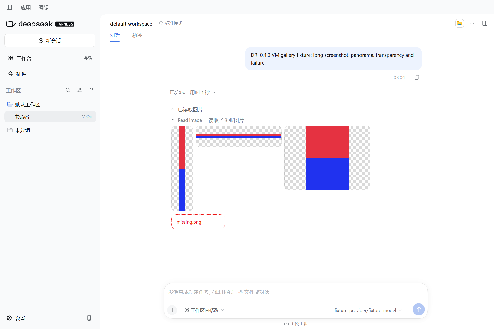
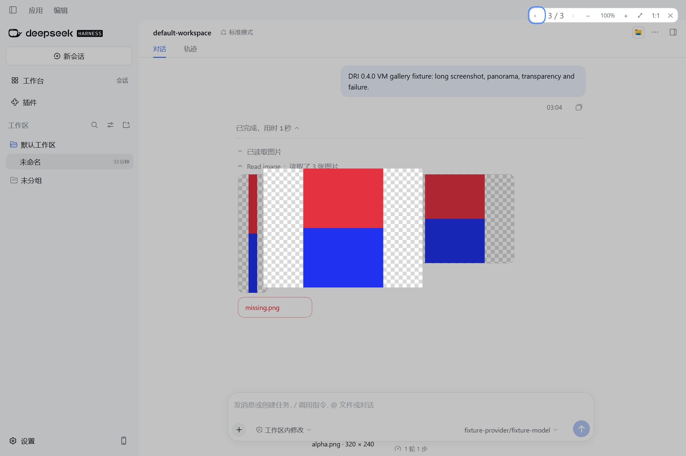

# dsh-read-image-view

[](https://github.com/Yu-tao-Li/dsh-read-image-view/actions/workflows/ci.yml) [](https://github.com/Yu-tao-Li/dsh-read-image-view/releases)

[中文](#中文) · [English](#english)

<a id="中文"></a>
## 中文

**把 DSH 的 `read_image` 结果变成完整图片预览和可缩放画廊。** 长截图、宽图和透明图都能在对话里直接看；一次返回多张图片也不会遗漏。

纯客户端插件，零生产依赖，使用宿主提供的会话授权图片加载器。

### 安装与使用

在 DSH 插件市场搜索 **dsh-read-image-view**，安装后重启 Harness。命令行 Web 用户也可以运行：

```powershell
dsh plugin --profile web add npm:dsh-read-image-view@0.4.0
```

随后重启 `dsh web`。让模型读取图片，点预览即可打开画廊。

**DSH Desktop：** 已在 Windows 11 虚拟机中验证 [DSH Desktop 0.11.1](https://github.com/dataelement/dsh-desktop/releases/tag/v0.11.1)，其内置 Harness 为 **0.2.0-rc.2**，使用桌面应用自己数据目录中的 **web profile**。优先在桌面应用内安装，再用 **Harness → 重启**。外部 CLI 的默认 DSH_HOME 可能指向另一套配置；使用 CLI 时须先指定桌面应用的实际 DSH_HOME。桌面版已管理过的插件可能使用独立版本目录，外部 CLI 安装会在重启时被旧登记覆盖，因此升级请使用应用内插件管理。

如果宿主折叠了“已完成”或“已读取图片”的工具过程，先展开该过程。插件自己的图片行默认展开。

### 0.4.0 有什么改进

| 功能 | 用法 |
| --- | --- |
| 完整预览 | 长图和宽图按完整比例放进卡片，不截掉底部或右侧 |
| 多图画廊 | 同次请求合并展示；一次工具结果里的所有图片均可切换 |
| 缩放与平移 | 滚轮、＋/−、拖动、双指缩放；适应窗口或 100% |
| 键盘 | ←/→ 切图，＋/− 缩放，`0` 为 100%，`f` 适应，Esc 关闭 |
| 焦点 | Tab/Shift+Tab 留在画廊内，关闭后返回打开图片的按钮 |
| 按需加载 | 接近视口才请求图片；失败可重试，关闭后异步结果不会重新弹出 |
| 透明图 | 卡片和放大层均有棋盘格，便于辨认透明区域 |

**100% 的含义：** 一个宿主返回位图像素对应一个 CSS 像素。宿主可能先缩小或转换源图；插件会显示返回尺寸，并在元数据可用时标明源图尺寸。放大超过 100% 会插值，不会恢复已丢失的细节。高 DPI 屏幕的物理像素与 CSS 像素也不同。

### 实际桌面验证

以下为虚拟机中真实 DSH Desktop 渲染器截图，使用宿主真实附件存储和持久化会话。验证数据为人工构造的工具结果，未调用模型。





测试环境为 Windows 11 22621.4112、150% DPI。覆盖三张图片、失败结果、切图、100%、键盘焦点、Esc 和重复打开。另有 Chromium 自动回归覆盖 12000px 长图、手机横竖屏、双指缩放、加载中关闭、重试和按需加载。

宿主实际拒绝 12000px 源图；桌面验证使用 600×8000 源图，宿主返回 561×7476 WEBP。插件遵守这条限制。兼容结论针对上述实测版本，其他宿主版本需要对应验证。

### 开发与资料

```powershell
npm ci
npm run build
npm run check
npm test
# 首次安装测试浏览器
node node_modules/playwright-core/cli.js install chromium
npm run test:browser
```

CI 运行纯逻辑与契约测试、bundle 同步检查和真实 Chromium 回归。`npm run e2e` 另需运行中的 DSH Web 会话。

源码入口：`src/client-src.js`；纯逻辑：`lib/read-image-core.mjs`；提交的发布 bundle：`lib/client.js`。加载、授权、缓存及 URL 生命周期由 DSH 宿主管理；插件不新增文件读取权限或网络端点，TUI 工具数据不受影响。

[20 项参考资料与采用理由](docs/upgrade-references.md) · [变更记录](CHANGELOG.md) · [发布流程](PUBLISH.md) · [MIT 许可](LICENSE)

---

<a id="english"></a>
## English

**Turn DSH `read_image` results into complete inline previews and a zoomable gallery.** View long screenshots, panoramas and transparency in the conversation, including every image in a multi-image result.

Client-only, with zero production dependencies and the host's session-authorized image loader.

### Install and use

Search for **dsh-read-image-view** in the DSH plugin marketplace, install and restart Harness. For a command-line Web installation:

```powershell
dsh plugin --profile web add npm:dsh-read-image-view@0.4.0
```

Restart `dsh web`, ask the model to read an image, then click its preview.

**DSH Desktop:** verified in a Windows 11 VM with [DSH Desktop 0.11.1](https://github.com/dataelement/dsh-desktop/releases/tag/v0.11.1), embedding Harness **0.2.0-rc.2**. It uses a **web profile** inside its own data directory. Prefer installing in the desktop app, then **Harness → Restart**. An external CLI's default DSH_HOME may belong to a different installation; set the desktop app's actual DSH_HOME before using CLI commands for it. Desktop also manages independent plugin generations: a CLI install can be overwritten by the previously registered generation on restart. Use the in-app plugin manager for upgrades.

If the host collapses the completed turn or image-reading tool process, expand that process first. The plugin's image row defaults to expanded.

### What's new in 0.4.0

| Feature | Interaction |
| --- | --- |
| Complete previews | Tall and wide images fit inside their cards without cropping |
| Multi-image gallery | Group reads within a request; navigate every image in each result |
| Zoom and pan | Wheel, +/−, drag and two-finger pinch; fit or 100% |
| Keyboard | ←/→ navigate, +/− zoom, `0` for 100%, `f` to fit, Esc to close |
| Focus | Tab/Shift+Tab stay inside the gallery; closing restores the opener |
| Deferred loading | Request images near the viewport; retry failures; late results cannot reopen a closed gallery |
| Transparency | Checkerboards in both cards and the gallery |

**100% means one returned bitmap pixel per CSS pixel.** The host can resize or convert the source first. The caption shows returned dimensions and source dimensions when provided. Zooming beyond 100% interpolates the bitmap; it cannot recover discarded detail. Physical screen pixels also differ from CSS pixels at high DPI.

### Actual Desktop validation

These screenshots come from the actual DSH Desktop renderer in the VM, using the real host attachment store and persisted session. Tool results were constructed as validation fixtures; no model calls were made.


Windows 11 22621.4112, 150% DPI: three images, an error result, navigation, 100%, focus, Esc and reopening. Separate Chromium regressions cover 12000px images, mobile orientation, real pinch input, close-during-load, retry and deferred loading.

The real host rejected a 12000px source image. Desktop validation used a 600×8000 source, normalized by the host to 561×7476 WEBP. The plugin preserves that boundary. Compatibility is verified for these specific versions; other host versions require their own checks.

### Development and references

```powershell
npm ci
npm run build
npm run check
npm test
node node_modules/playwright-core/cli.js install chromium
npm run test:browser
```

CI runs core/contract tests, bundle synchronization and actual Chromium regressions. `npm run e2e` additionally requires a running DSH Web session.

Source: `src/client-src.js`; pure logic: `lib/read-image-core.mjs`; committed release bundle: `lib/client.js`. DSH owns loading, authorization, caching and URL lifetime. The plugin adds no file permissions or network endpoints and leaves TUI tool data unchanged.

[20 primary references and design decisions](docs/upgrade-references.md) · [Changelog](CHANGELOG.md) · [Publishing](PUBLISH.md) · [MIT](LICENSE)
